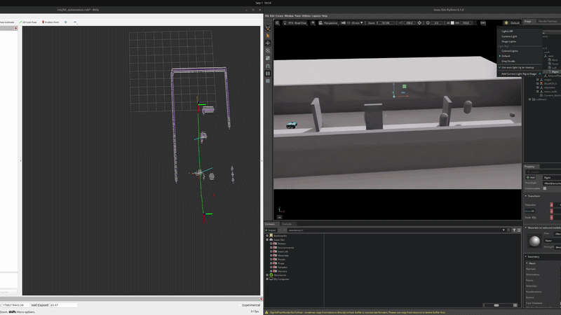

# BlueROV BT Autonomous — Point A to B

Hey — welcome to the repo. Here's what this is and how to get going with it.

This is a standalone slice of a much bigger MarineGym / IsaacLab research
monorepo, pulled out so it only contains what you need to run one specific
task: a simulated BlueROV navigating from a fixed start point to a fixed
goal, through static maze walls and moving obstacles, using a rule-based
behavior-tree controller (no trained RL policy involved). It builds its own
sonar/depth-based occupancy map as it goes — no ground-truth shortcuts — and
plans its path with RRT/Voronoi. Everything Isaac Sim does gets bridged out
to ROS 2 so you can watch it live in RViz.

If you're new here, this README is the map of the repo — read it top to
bottom once, then come back to whichever section you need.

## What's actually in here

```
release/scripts/   Launcher shell scripts — this is what you actually run
scripts/            Python entrypoints Hydra calls into (env launcher, BT controller, ROS2<->UDP bridges)
cfg/                 The Hydra config tree — this is where you tune behavior, not the Python
                     cfg/debug/bt_auto_point_a_to_b.yaml is the point-A-to-B preset — edit it directly
src/bluerov_manual/  The env + navigation Python package the scripts import
assets/usd/          The bundled tank scene (BlueROV/tank.usd) — self-contained, nothing external needed
rviz/                RViz config, already set up for the topics below
docs/                Everything below the surface: setup, environment customization, physics, walkthroughs
```

A good mental model: **`release/scripts/` is what you type, `cfg/` is what
you edit, and `src/`/`scripts/` is what you'd only touch if you're actually
changing behavior in code.** Almost everything you'll want to do — change
the start/goal, add obstacles, swap the tank, retune the controller — is a
config edit, not a code change.

## Before you can run anything

For a fresh machine, follow **[INSTALLATION.md](INSTALLATION.md)**. It is the
authoritative, end-to-end guide for the tested Isaac Sim 5.1 + IsaacLab v2.3.2
+ MarineGym + ROS 2 Jazzy stack, including verification and troubleshooting.

This repo doesn't carry Isaac Sim or the physics engine with it — those are
big, shared dependencies you're expected to already have (or set up once).
Here's what you need:

- **Isaac Sim.** Point `ISAAC_PY` at your Isaac Sim Python wrapper (defaults
  to `/home/eth11/isaacsim51/python.sh` if you don't set it).
- **`marinegym`.** This is the framework that actually simulates the
  underwater physics — buoyancy, drag, thrusters, the works (there's a
  whole doc on this, [docs/UNDERWATER_PHYSICS.md](docs/UNDERWATER_PHYSICS.md),
  if you want to know exactly what it's doing under the hood). This repo
  just imports it as a normal Python package
  (`marinegym.envs.isaac_env`, `marinegym.envs.single.hover`,
  `marinegym.sensors.*`, `marinegym.utils.*`,
  `marinegym.controllers.hardcoded_mixer`), so you'll need
  `<isaac-python> -m pip install -e .` run once from the
  [NTNU MarineGym compatibility repository](https://git.ntnu.no/mded/marinegym-isaacsim51).
  It also owns the BlueROV robot model itself — only the static tank
  scene ships in this repo, not the ROV. If you're setting this up on a
  fresh machine, use [INSTALLATION.md](INSTALLATION.md).
- **ROS 2 Jazzy** (`rclpy`, `sensor_msgs`, `nav_msgs`, `geometry_msgs`,
  `tf2_ros`, `visualization_msgs`) — just `source /opt/ros/jazzy/setup.bash`
  before running the bridge scripts or `rviz2`.
- The Python side (`hydra-core`, `omegaconf`, `torch`, `tensordict`,
  `numpy`) already ships inside Isaac Sim's bundled Python, so you don't
  need to install these separately.

No trained policy checkpoint anywhere in this loop — the thing driving the
ROV (`scripts/play_bluerov_behavior_tree_maze.py::RobustMazeBTController`)
is hand-written behavior-tree logic, not a neural net, so there's nothing to
download or train first.

## The tank scene, briefly

The tank USD is bundled right in the repo at `assets/usd/BlueROV/tank.usd`
and is what loads by default — you don't need `marinegym` for it, and you
don't need to be on any particular machine or directory layout for it to
resolve correctly. If you ever want to swap in your own scene, or retune
the tank bounds / maze walls / obstacles, that's all covered in
[docs/CUSTOM_ENVIRONMENT.md](docs/CUSTOM_ENVIRONMENT.md) — I'd start there
before touching any Python.

## Running the point-A-to-B task

Once your dependencies are sorted, this is a three-terminal workflow. Open
each of these in its own terminal, from the repo root, with
`source /opt/ros/jazzy/setup.bash` run first in each.

**Terminal 1 — the ROS2 bridges.** This is what turns Isaac Sim's internal
state into ROS topics RViz can actually see:

```bash
bash release/scripts/00_ros2_bridges.sh
```

**Terminal 2 — RViz**, so you can watch it happen:

```bash
rviz2 -d rviz/bt_autonomus.rviz
```

Set the fixed frame to `map` once it opens.

**Terminal 3 — the actual run.** This used to be a 40-line command with
every parameter inlined — I moved all of that into
[`cfg/debug/bt_auto_point_a_to_b.yaml`](cfg/debug/bt_auto_point_a_to_b.yaml)
so you can just open that file and edit whatever you want to change (start
position, goal, how many walls, obstacle speed, BT tuning, all of it),
instead of hunting through a wall of CLI flags. Once you're happy with it,
this is all you run:

```bash
HEADLESS=false \
ROS2_TELEMETRY_ENABLE=true \
ROS2_TELEMETRY_SEND_RGB=true \
ROS2_TELEMETRY_SEND_DEPTH=true \
NUM_ENVS=1 \
STEPS=30000 \
bash release/scripts/01_run_bt_auto_point_a_to_b.sh
```

The env vars up top still work the way you'd expect (headless mode,
telemetry, how many steps to run). And if you just want to tweak one thing
for a single run without touching the config file, you can still pass it
straight on the command line — it'll override whatever's in the preset:

```bash
bash release/scripts/01_run_bt_auto_point_a_to_b.sh task.obstacles.num=5
```

## Where to go from here

Depending on what you're trying to do next, here's where I'd point you:

- Want to drive the ROV yourself with a joystick or keyboard, or just poke
  at ROS topics? [docs/QUICKSTART.md](docs/QUICKSTART.md) walks through
  every mode this repo supports, not just the BT-autonomous one.
- Want a different tank, or to move the walls/obstacles/start/goal around?
  [docs/CUSTOM_ENVIRONMENT.md](docs/CUSTOM_ENVIRONMENT.md) explains how the
  scene is actually assembled (three separate pieces — the tank mesh, the
  procedural walls/obstacles, and the robot — and you can swap or retune
  each independently) and gives you the exact config keys.
- Curious what's physically being simulated — is it "real" underwater
  physics or a shortcut, does it run on GPU, how does the BT controller
  relate to vehicle stabilization? [docs/UNDERWATER_PHYSICS.md](docs/UNDERWATER_PHYSICS.md)
  traces the whole force pipeline down to file:line citations, has a
  diagram, and is honest about what I've tested and what still needs
  tuning.
- Setting this up on a machine that's never seen Isaac Sim or MarineGym
  before? [INSTALLATION.md](INSTALLATION.md) is the from-scratch path.

## Useful RViz/ROS2 topics

Once the bridges are running, these are the topics worth knowing:

```
/bluerov/pose
/bluerov/odom
/bluerov/status
/bluerov/trajectory
/bluerov/path
/bluerov/map
/bluerov/map_occ/points
/bluerov/map_occ/hit_points
/bluerov/map_occ/scan_origin
/bluerov/sonar/scan
/bluerov/sonar/hits
/bluerov/obstacles
/bluerov/dynamic_obstacles_estimated
/bluerov/rgb/image
/bluerov/depth/image
/tf
/tf_static
```

If you just want to sanity-check things are alive before opening RViz:

```bash
ros2 topic list
ros2 topic echo /bluerov/pose --once
ros2 topic echo /bluerov/sonar/scan --once
ros2 topic echo /bluerov/status --once
ros2 topic echo /tf_static --once
```

## Demo

This short clip shows the BlueROV navigating the maze from a fixed start point to the goal using the behavior-tree controller.

