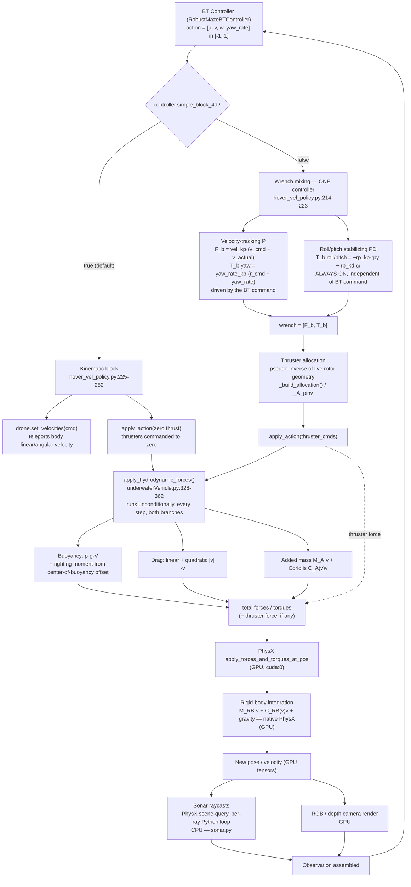

# Underwater Physics & Modeling

This is the deep-dive doc — where the underwater dynamics actually live,
what's genuinely on vs. off in the default run, whether it's a textbook
Fossen model, how the BT controller relates to vehicle stabilization, and
what actually runs on GPU vs. CPU. I traced all of this down to specific
file:line citations rather than guessing, and where I say something was
"tested," I mean I actually ran it and I'm reporting the real numbers, not
what I expect should happen.

None of the physics itself lives in this repo — it's all in the external
`marinegym` package, specifically
`marinegym/robots/drone/underwaterVehicle.py` and
`marinegym/envs/single/hover.py`. This repo's `HoverVelStableGoal` task
(`src/bluerov_manual/envs/hover_vel_stable_goal.py`) inherits from that and
layers maze/obstacle/mapping logic on top, but it never touches the physics
itself.

## The shape of one simulation step

Before getting into the details, it helps to see the whole pipeline at
once — from the BT controller's action, through whichever mode you're
running in, out to the forces that actually move the vehicle, and back
around to the next observation. The two `simple_block_4d` branches diverge
early, but they rejoin at `apply_hydrodynamic_forces` — and that's worth
noticing, because buoyancy/drag/added-mass get computed **every step in
both branches**, not just the "full physics" one:



Keep this diagram in mind as you read the rest — most of the questions
people ask about this repo ("is X really physics or is it faked", "does
stabilization happen", "is this on GPU") are really just "which box in this
diagram are we talking about."

## The model, piece by piece

Isaac Sim's own PhysX rigid-body simulation — gravity, mass, inertia,
collisions — runs completely unmodified underneath all of this. It's
already handling the rigid-body terms `M_RB·v̇ + C_RB(v)v` and gravity on
its own; nothing in this repo or in `marinegym` reimplements that part.
What gets added on top is the underwater-specific behavior, computed fresh
every step as explicit forces and torques inside
`apply_hydrodynamic_forces`:

- **Buoyancy** — `buoyancyForce = ρ_water * g * volume`
  (`underwaterVehicle.py:401-411`, ρ = 997 kg/m³), plus a righting moment
  that comes from the center-of-buoyancy offset (`coBM`). Both volume and
  `coBM` are per-vehicle constants sitting in `BlueROV.yaml`. It's gated by
  `self.enable_buoyancy` (`True` by default, though this repo doesn't
  expose it as a Hydra key — you'd need to edit `underwaterVehicle.py`
  directly to turn it off).
- **Drag / damping** — linear plus quadratic (∝ |v|·v) damping, with 6-DOF
  coefficients coming from `BlueROV.yaml`'s `hydro_coef` block
  (`underwaterVehicle.py:373-383`).
- **Added mass and Coriolis coupling** — the added-mass matrix `M_A` comes
  from `hydro_coef.added_mass`, and the Coriolis-centripetal term is
  derived from it via cross products (`underwaterVehicle.py:385-399`).
- **The thruster model** — six T200-style rotors, each with its own
  RPM/thrust curve and `tau_up`/`tau_down` spin-up/spin-down time constants
  (`underwaterVehicle.py:216-243`, configured in `BlueROV.yaml`'s
  `rotor_configuration`). Each rotor's thrust resolves into a body-frame
  force/torque based on that rotor's actual pose, not an idealized one.
- **How it all comes together** — hydro forces (buoyancy + drag + added
  mass + Coriolis) plus whatever thruster force exists get summed and
  pushed into PhysX once per step:
  ```python
  # underwaterVehicle.py:320-324
  self.base_link.apply_forces_and_torques_at_pos(
      self.forces.reshape(-1, 3), self.torques.reshape(-1, 3), is_global=False
  )
  ```

## Is this actually the Fossen model?

Short answer: structurally, yes — though nobody in `marinegym` ever says so
out loud. I grepped for "fossen" across the whole package and got nothing;
it's unattributed in code and comments alike. But the math itself is the
standard 6-DOF marine-vehicle equation of motion,
`M·v̇ + C(v)v + D(v)v + g(η) = τ`, and it's split across exactly the two
layers you'd expect if you were building this the sensible way:

- **PhysX handles `M_RB·v̇ + C_RB(v)v` and gravity natively** — the
  rigid-body half of the equation isn't reimplemented anywhere in this
  code, it's just Isaac Sim doing what it always does.
- **`underwaterVehicle.py` supplies only the hydrodynamic add-on**:
  `M_A·v̇ + C_A(v)v + D(v)v + g(η)` — added mass, the added-mass-derived
  Coriolis term, drag, and buoyancy — applied as external forces on top of
  PhysX's own integration. This is exactly the textbook-correct way to bolt
  Fossen-style hydrodynamics onto a general-purpose rigid-body engine,
  instead of hand-rolling the entire equation of motion from scratch.
- One place it simplifies relative to a fully general Fossen model:
  `calculate_added_mass` uses a diagonal `M_A` with no off-diagonal
  coupling terms, and `calculate_damping` is diagonal-dominant with just a
  handful of explicit roll/yaw cross terms. That's a reasonable, common
  simplification for a vehicle shaped like a BlueROV — not a full general
  6×6 added-mass matrix, but not wrong for this either.

## Stabilization and the BT controller — how they actually relate

If you're picturing "an inner stabilization controller keeping the ROV
upright, with the BT controller commanding on top of it," you're basically
right about the *effect*, but the *implementation* is a little different
from two cascaded loops — worth knowing precisely, because it changes
between the two run modes:

- **With `simple_block_4d=false` (full physics):** surge/sway/heave and
  yaw-rate tracking come straight from whatever `[u, v, w, r]` the BT
  controller outputs (`F_b`, `T_b.yaw`), while roll/pitch stabilization
  (`T_b.roll/pitch = −rp_kp·rpy − rp_kd·ω`, on by default via
  `stabilize_rp: true`) gets computed **every single step, unconditionally**,
  regardless of what the BT controller is doing. Both pieces get summed
  into one wrench and go through the same thruster allocation together — so
  functionally it behaves exactly like an always-on attitude-hold sitting
  underneath the BT controller's translation/heading commands, even though
  under the hood it's one combined computation rather than two separate
  control loops running at different rates.
- **With `simple_block_4d=true` — the mode this repo actually runs by
  default:** there's **no active roll/pitch stabilization at all**. That
  code path (`hover_vel_policy.py:225-252`) returns before it ever reaches
  the `stabilize_rp` block — it just teleports velocity directly and zeroes
  the thrusters. So any attitude-holding you notice in the default mode is
  entirely **passive** — just the buoyancy righting moment (from the
  center-of-buoyancy offset) doing its thing, which still runs every step
  even with zero thrust commanded.

This means if what you actually want is "stabilized ROV, BT commands
`[u,v,w,r]`, and everything flows through real underwater physics" — that's
`simple_block_4d=false` with `stabilize_rp=true` (the default). That
combination already exists in the code; you don't need to build anything
new. The catch is in the next section.

## What actually drives the ROV by default, and what happens when you turn full physics on

The preset this repo ships with
(`cfg/debug/bt_auto_point_a_to_b.yaml`, via `hover_vel_stable_goal.yaml`)
sets `controller.simple_block_4d: true` — a kinematic bypass. Instead of
going through thruster allocation and letting forces integrate, the BT
controller's `[surge, sway, heave, yaw_rate]` directly overwrites the rigid
body's velocity (`drone.set_velocities(...)`). The hydrodynamic forces
(buoyancy/drag/added-mass/Coriolis) are still being computed and applied
every step even here — they just don't have much room to actually do
anything, because velocity keeps getting re-forced to the command before
they'd have a chance to accumulate any real effect.

If you want the ROV genuinely driven by the physics — real thruster forces,
real drag, real everything — this is how you switch:

```bash
bash release/scripts/01_run_bt_auto_point_a_to_b.sh \
  task.controller.simple_block_4d=false \
  task.controller.simple_block_zero_thrusters=false
```

Here's what I actually found when I tested it, so you know what to expect
rather than being surprised by it. Same scenario as the default preset — 500
steps, headless, identical start/goal/maze/obstacles:

| | Default gains (`vel_kp=2.0`, `yaw_rate_kp=1.5`, `max_accel=1`) | Retuned (`vel_kp=6.0`, `yaw_rate_kp=4.0`, `max_accel=4.0`) | Default kinematic mode, for reference |
|---|---|---|---|
| Collisions in 500 steps | 7 | 5 | 0 |
| Best progress reached | stuck around `goal_dist≈13.2` | one episode got to `goal_dist=12.0` at step 120, real progress | `goal_dist` 14.0 → 11.2 over 360 steps |

So: turning up the velocity-tracking gains genuinely helped once — that
120-step run was the best result across everything I tried in full-physics
mode — but it didn't fix the underlying issue, and most episodes still
crashed within 30-90 steps either way.

**Why this happens**: the BT controller's tuning (`avoid_dist`,
`replan_dist`, and the various timing thresholds in
`cfg/debug/bt_auto_point_a_to_b.yaml`) was effectively tuned against the
kinematic mode's instant response — command a turn, and in kinematic mode
the ROV is instantly pointed that way. With real physics, there's
unavoidable lag from inertia and drag between "the BT decides to turn" and
"the ROV is actually turned," and during that window it keeps moving on its
old heading. Cranking up the P-gains speeds up how fast velocity converges,
but it can't remove that lag entirely — which is presumably why the
retuned gains helped but didn't solve it. If you want to keep pushing on
this, the more promising lever is probably giving the BT controller bigger
safety margins (larger `avoid_dist`, earlier replanning distances) to
compensate for the lag directly, rather than just chasing faster inner-loop
gains — but I haven't validated that yet, so treat it as a starting point
rather than a fix.

One more thing worth flagging so you don't confuse it with any of the
above: there's a separate, unrelated bypass called `HardcodedMixer`
(`marinegym/controllers/hardcoded_mixer.py`) — a fixed, calibrated 6×4
thruster allocation matrix. It's only wired into `HoverTankPPO`
(`src/bluerov_manual/envs/hover_tank_ppo.py`), not into the
`HoverVelStableGoal` task this repo actually runs, so if you go poking
around `controller.*` config and see it referenced elsewhere, it's not
relevant to anything in this repo's run path.

## Currents and payload disturbances — off by default, but they work

`cfg/task/hover_vel_stable_goal.yaml`'s `disturbances:` block has two
knobs: `payload` (extra mass plus a vertical offset, applied through a
prismatic joint) and `flow` (a water-current velocity that gets subtracted
from the vehicle's velocity before drag is computed). Both are fully
implemented and functional (`hover.py:643,710-722`) — they're just off
(`enable_payload`/`enable_flow` both `false`) for this particular task. If
you want to add a current, for example:

```bash
bash release/scripts/01_run_bt_auto_point_a_to_b.sh \
  task.disturbances.play.flow.enable_flow=true \
  task.disturbances.play.flow.max_flow_velocity=[0.1,0,0,0,0,0]
```

(It's `play` specifically because `mode: play` is what this repo always
launches with — MarineGym indexes disturbances by `train`/`eval`/`play`
separately.)

## Is everything actually running on GPU?

Mostly, yes — with one genuinely CPU-bound piece worth knowing about:

- **Physics and tensors: GPU (`cuda:0`).** `cfg/base/sim_base.yaml` sets
  `use_gpu_pipeline: true`, `device: "cuda:0"`, `use_gpu: true`. Worth
  noting: the drone's actual device comes from Isaac Sim's live
  `SimulationContext` (`marinegym/robots/robot.py`) at runtime, not from
  the `device="cpu"` default parameter you'll see on
  `UnderwaterVehicle.make()` — that parameter is genuinely dead code, never
  read anywhere inside the method, and the one call site in
  `marinegym/envs/single/hover.py` doesn't even pass a device argument
  either way. So don't let that default fool you; all the hydrodynamics,
  thruster allocation, and rigid-body integration really do run on GPU.
- **Camera rendering: GPU**, through Isaac Sim's RTX renderer.
- **Sonar: CPU**, and this is the one you should actually plan around.
  `src/bluerov_manual/navigation/sonar.py` uses PhysX's scene-query
  interface (`get_physx_scene_query_interface`, `raycast_closest`) inside a
  nested Python loop over `env_idx` / `ray_idx` — a genuinely serial,
  one-raycast-at-a-time CPU call, because PhysX scene-query raycasts simply
  aren't GPU-batched in Isaac Sim. Origins and directions get explicitly
  moved to CPU before the loop runs, and results are written back
  element-by-element into a CUDA tensor afterward. This scales as
  `num_envs × num_rays` raycasts every single step, and it's the main CPU
  bottleneck in this task's per-step cost — so if you crank up
  `sonar.num_rays` or `NUM_ENVS` and notice wall-clock time growing faster
  than you'd expect from the GPU load alone, this is almost certainly why.

## Where the vehicle's physical constants actually live

Mass, inertia, volume, center-of-buoyancy, the hydrodynamic coefficients,
and the rotor configuration all come from one file:
`marinegym/robots/assets/usd/BlueROV/BlueROV.yaml`, inside your `marinegym`
checkout — none of it lives in this repo. If you ever need to retune the
vehicle's actual physical model (as opposed to the scene or task, which is
[CUSTOM_ENVIRONMENT.md](CUSTOM_ENVIRONMENT.md) territory), that YAML file
is where to look. If you're not sure where your `marinegym` checkout even
is yet, [MARINEGYM_SETUP.md](MARINEGYM_SETUP.md) walks through getting one
set up.
